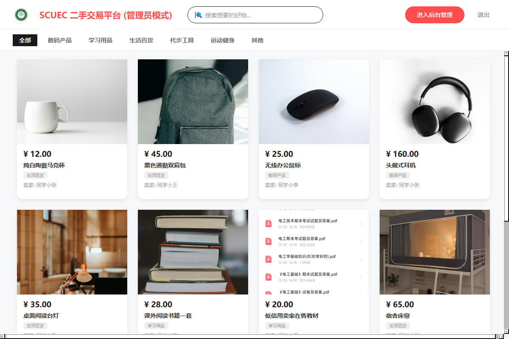
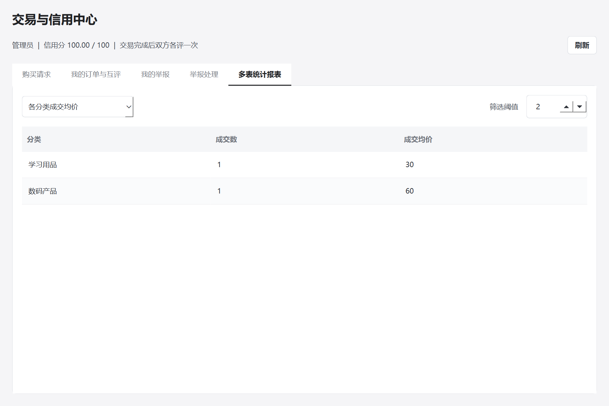
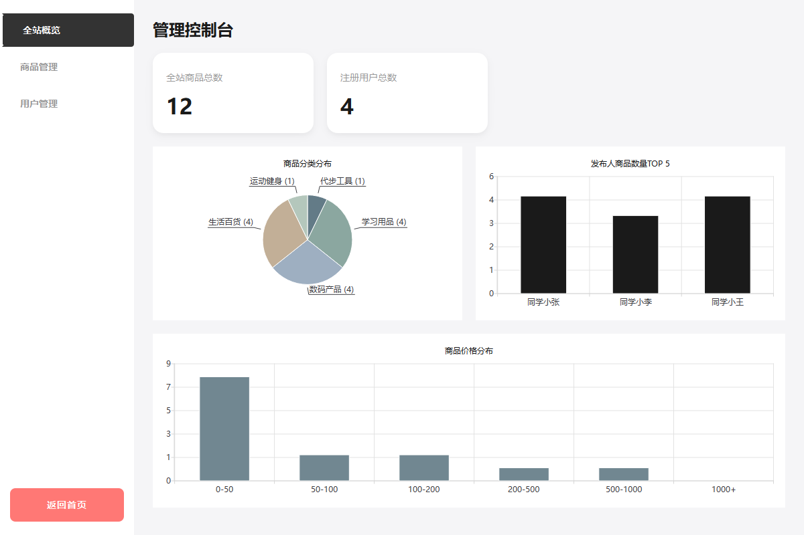

# CampusMarket · 校园二手交易平台

基于 **Qt 6 Widgets + MySQL** 的校园二手交易小项目，覆盖商品发布、购买请求、订单确认、双方互评、信用评分与举报处理。适合数据库课程实验和 Qt 桌面开发练习。



## 可以做什么

- **校园闲置交易**：注册登录、分类浏览、发布商品、成色与价格、图片上传、咨询留言。
- **完整交易流程**：买家请求 → 卖家接受 → 订单预订 → 买家收货 → 双方互评；取消后可重新发起购买。
- **信用与举报**：MySQL 触发器汇总信用分，管理员核实举报并下架商品或冻结用户。
- **数据库实验**：软删除、商品与历史订单一对多、订单评价唯一约束、外键和 CHECK、事务与行锁。
- **查询报表**：分类成交均价、低信用活跃卖家、交易明细、超阈值商品和用户，共 5 个连接查询。
- **中文搜索**：标题、描述使用 MySQL ngram 全文索引，单字查询使用参数化 LIKE。

## 快速体验

在 [Releases](https://github.com/Jian1202/campus-market-qt/releases/latest) 下载 Windows 交付包，解压后打开“运行程序”目录，双击 **运行演示.cmd**。

需要 **Windows 64 位、MySQL Server 8.x、Python 3.10+**。仅安装 MySQL Workbench 不够。Qt 运行库和 QMYSQL 驱动随交付包提供；首次启动会安装 Python 依赖，之后可以离线使用。

启动器创建独立演示实例，默认使用 `127.0.0.1:3317`，无需已有数据库的 root 密码。数据保存在 `C:/Users/Public/CampusMarketDemo`。再次启动会保留数据，并在校验后复用已运行的本项目实例。

| 角色 | 账号 | 密码 |
|---|---|---|
| 管理员 | `admin` | `admin123` |
| 学生 | `202600000001`～`202600000004` | `123456` |

以上都是公开的教学演示账号，商品价格、成色、评价和举报也均为样例数据。

## 从源码运行

本仓库保留源码与材料，DLL 和 exe 通过 Releases 提供。当前 Windows 依赖对应 **Qt 6.11.1 / MinGW 64 位**。

1. 克隆仓库，安装 Qt 的 Widgets、Sql、Charts 模块。
2. 下载 Release 交付包，将其中的 **运行程序** 文件夹复制到仓库根目录，与 `src`、`tools` 同级。
3. Qt Creator 打开 `ScuecMarket.pro` 或 `CMakeLists.txt`，选择对应套件后构建。
4. 构建会自动复制驱动、运行库、图片和启动工具。初次运行可双击 **构建输出目录**中的 `运行演示.cmd`，启动自己刚编译的程序。

如需在 Qt Creator 里直接运行或断点调试，需要先初始化并配置保持运行的 MySQL 数据库，见 [开发与运行说明](docs/development.md)。

## 页面预览

| 交易与报表 | 管理概览 |
|---|---|
|  |  |

## 项目结构

```text
src/                 Qt 页面与数据库访问层
database/            建表、演示数据、增量商品和报表 SQL
resources/           原项目图片与本地网络素材
tools/               数据库初始化、演示启动、构建后部署、QMYSQL 驱动源码
tests/               MySQL 集成验证、驱动检查、界面预览
docs/                数据库设计、开发说明、演示路线与截图
third_party/         第三方许可证
ScuecMarket.pro      qmake 工程
CMakeLists.txt       CMake 工程
```

## 设计中的几个取舍

- 单件闲置商品采用“可售 / 预订 / 已售”三态；下架标记 `is_deleted=1`，历史交易不删除。
- 购买意向与正式订单分表；卖家接受意向后才生成订单。
- 同一商品可以保留多笔取消订单，通过生成列唯一索引限制最多一笔有效订单。
- **每个订单一行双向评价**：`Review.order_id` 唯一，买卖双方各填一组评分和评语，分别只能提交一次。
- 信用分为收到的全部评分平均值 × 20，无评价时默认为 100。
- 这是本地桌面实验项目，Qt 客户端直接连接 MySQL；面向公共网络的部署需要增加服务端。

更多内容：[数据库设计](docs/database-design.md) · [实验演示](docs/demo-guide.md) · [素材来源](docs/image-sources.md) · [验证说明](docs/validation.md)。

Qt 驱动保留官方源文件的版权及许可证；网络配图的作者和原始链接见素材来源。预编译运行包保留对应第三方许可证。
