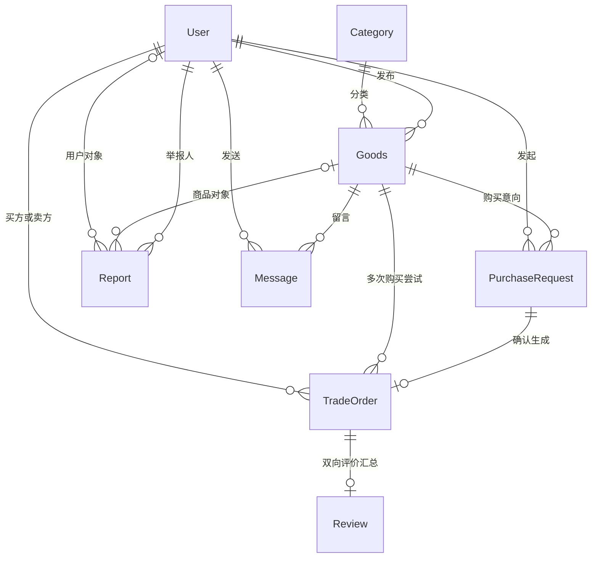

# 数据库设计说明

## 1. 概念结构

User、Category、Goods、TradeOrder、Review、Report 是六个核心对象；PurchaseRequest 单独记录成交之前的意向，Message 沿用原项目咨询功能。商品为单件二手物品，因此库存采用 available / reserved / sold 三态，不用多件库存数量。

## 2. 逻辑表与主要字段

完整类型、长度、索引与 CHECK 以 `database/schema.sql` 为准。

| 表 | 主键 | 主要属性及关联 |
|---|---|---|
| User | id | student_id 唯一；name、password、contact、role、status、credit_score |
| Category | id | name 唯一，避免商品分类文本重复维护 |
| Goods | id | name、DECIMAL(10,2) price、description、condition_desc、image_path；category_id、publisher_id 外键；status、is_deleted |
| PurchaseRequest | id | goods_id、buyer_id 外键；status、created_at；待处理请求生成键 |
| TradeOrder | id | request_id 唯一外键；goods_id、buyer_id、seller_id 外键；amount 订单价格快照、status、completed_at |
| Review | id | order_id 唯一外键；buyer_rating/comment/reviewed_at；seller_rating/comment/reviewed_at |
| Report | id | reporter_id；target_type；goods_id 或 user_id；reason、status、handler_id、result_note、handled_at |
| Message | id | goods_id、sender_id 外键；content、timestamp |

订单保存 seller_id 和成交价快照，使订单解释不依赖商品后续修改；交易入口检查其与商品发布人一致。各表均为 InnoDB、utf8mb4；所有业务引用保留外键，未使用级联删除。

## 3. 题目要求到实现的对应

| 要求 | 实现位置与保证 |
|---|---|
| 商品软删除 | Goods.is_deleted；DbManager::removeGoods / softDeleteGoods；首页条件固定含 is_deleted=0 |
| 商品与订单 1:N，仅一单成交 | TradeOrder.goods_id 非唯一，允许多笔 cancelled；live_goods_id 生成列配合唯一索引，confirmed/completed 最多一条 |
| 每单只评价一次 | Review.order_id UNIQUE，单行保存两方互评；每个评分字段只允许从 NULL 填入一次 |
| 举报人、商品或用户、状态 | Report 两个对象外键 + target_type + CHECK 二选一；pending/resolved/dismissed 三态 |
| 确认订单与库存联动 | confirmRequest、finishOrder、cancelOrder 内部事务和 FOR UPDATE 行锁；失败整体回滚 |
| 信用分维护 | review_after_update 触发器，按评价接收方重算 |
| 超阈值商品/用户 | reportData(3/4) 与 reports.sql 第4、5项，统计独立待处理举报人数并 HAVING COUNT DISTINCT > 阈值 |
| 三个多表连接报表 | 分类均价、低信用活跃卖家、订单明细；另有两张举报报表 |
| 全文检索加分项 | Goods(name,description) FULLTEXT WITH PARSER ngram；MATCH AGAINST 绑定关键词 |

## 4. 约束与状态机

### 商品和订单

- available 可接受购买请求；请求本身不占用库存。
- 卖家接受请求后，事务创建 confirmed 订单，把商品变成 reserved，把该请求设为 accepted，拒绝其他 pending 请求。
- 买家确认收货后，商品变为 sold，订单变为 completed，创建空的双向评价记录。
- confirmed 可以取消为 cancelled，同时恢复 available；completed 与 cancelled 均不能回退。
- uq_one_live_order 利用 MySQL UNIQUE 对多个 NULL 的允许，保留取消历史，又阻止两个有效订单。
- 买方不能等于卖方，订单金额非负；订单主体和金额由 order_before_update 触发器禁止篡改。

### 评价与信用

Review 不用 UNIQUE(order_id,reviewer_id)，因为题目要求每单唯一。buyer_rating 是买家给卖家的评分；seller_rating 是卖家给买家的评分。双方可不同时提交，未提交为 NULL。

review_before_insert 保证评价记录只为已完成订单初始化，且初始评分为空。review_before_update 禁止覆盖已提交方的评分、评语、时间和订单归属。应用层限制为该订单当事人，并以 `..._rating IS NULL` 更新保证同方不可重复提交。

信用分计算示例：卖家收到买方 2 分，信用为 40；另一次收到 3 分，信用为 (2+3)/2×20=50。该用户作为买家收到的评分也纳入同一个平均值。默认 100 表示没有评分，不能解释为已有满分历史。

提交评分时先按用户 ID 排序加锁交易双方，连接采用 READ COMMITTED；避免并发给同一个人评价导致汇总遗漏。信用分由触发器更新，评价和信用在同一个事务中提交。

### 举报与冻结

Report 中恰好一个目标字段非空，对象由外键保证存在。对同一人和同一对象建唯一键，防止重复计数。阈值默认 2，“超过”即至少 3 位不同举报人；只统计待处理记录，已驳回/已处置不再进入待处理风险列表。

下架保留商品、订单、评价和举报。冻结还会取消用户作为买家或卖家的待收货订单，并释放其他卖家的预订商品；该用户自己的商品全部软删除。解冻只恢复账号使用权限，不自动重新上架商品。

handleReport 锁定举报记录后在同一事务完成下架/冻结与结案，填写处理人、说明和处理时间。处置前可按阈值筛选，单条举报核实违规后也允许处理，不必机械等待达到阈值。

## 5. 查询与索引

1. 分类成交均价：Category → Goods → TradeOrder，统计 completed 订单成交价，不用挂牌价替代。
2. 低信用活跃卖家：User → Goods → TradeOrder，信用低于阈值且近30天发布过商品；只计正常账号，发布数包含保留的下架历史。
3. 订单明细：TradeOrder → Goods → Category → 买家 User → 卖家 User → Review。
4. 商品风险：Report → Goods → User，独立举报人数大于阈值。
5. 用户风险：Report → User，独立举报人数大于阈值。

报表不丢弃软删除商品的历史成交。首页商品列表与统计历史交易使用不同条件，避免“下架商品消失，成交报表也一起消失”。应用程序报表参数使用绑定，不拼接用户输入。

全文检索使用 ngram，MySQL 默认通常按两个字符切分。至少两字符的关键词使用 MATCH AGAINST；单字符使用参数化 LIKE。NATURAL LANGUAGE 模式按词片匹配，输入长句不保证严格连续子串匹配；英语和停用词结果也受服务器全文配置影响。

## 6. 数据库权限与初始化

初始化工具只接受空数据库，不删除或覆盖旧库。创建独立应用账号，授予 SELECT、INSERT、UPDATE，不授予 DELETE、DDL 或账号管理权限。触发器由初始化管理员创建并执行信用更新。

用户注册密码采用每人随机盐 + PBKDF2-HMAC-SHA256（120000 次），数据库不保存明文。演示 seed.sql 的账号及口令是公开教学数据。照片以可迁移的相对路径保存，预设图仍使用 Qt 资源路径。
